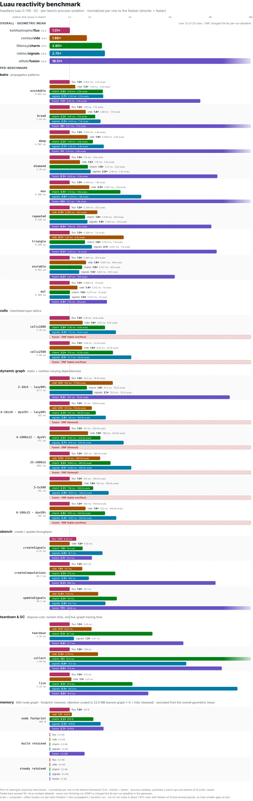

# Luau Reactivity Benchmark

[](https://github.com/kohltastrophe/luau-reactivity-benchmark/actions/workflows/runner.yml) [](LICENSE.md)

A Luau port of [js-reactivity-benchmark](https://github.com/milomg/js-reactivity-benchmark) comparing [Flux](https://github.com/kohltastrophe/flux), [Vide](https://github.com/centau/vide), [Fusion](https://github.com/dphfox/Fusion), [Charm](https://github.com/littensy/charm), and [signals](https://github.com/Roblox/signals) across identical dependency graphs. Every adapter in `adapters/` runs headless under the `luau` CLI and renders to a single chart.

<a href="https://raw.githubusercontent.com/kohltastrophe/luau-reactivity-benchmark/assets/chart.svg"></a>

## Running it

Requires Python 3.11+, [`luau`](https://github.com/luau-lang/luau), and [`wally`](https://github.com/UpliftGames/wally) on `PATH`.

```sh
python3 benchmark.py                                # -> bench/results.json, bench/memory.json, chart.svg, chart-small.svg
python3 benchmark.py --passes 3                     # keep each row's fastest across 3 interleaved passes
python3 benchmark.py --flag=--codegen               # native codegen instead of -O2 interpreter
python3 benchmark.py --verify                       # correctness gate only
python3 benchmark.py --filter signals vide          # print tables for selected adapters without overwriting files
python3 benchmark.py --filter signals vide --write  # also write partial JSON and SVG files
python3 chart.py --flag=--codegen                   # re-render existing JSON results (omit --flag for default -O2)
```

1. **Assemble** ([`assemble.py`](assemble.py)): runs `wally install` whenever `wally.toml`, `wally.lock`, or `assemble.py` changes, rewrites Roblox instance `require(...)` chains and `Packages/_Index` shims to Luau string requires, and writes `@<name>` aliases to `.luaurc`.
2. **Measure** ([`bench/main.luau`](bench/main.luau)): runs every `(adapter, bench)` pair in its own `luau` process (capped by `BENCH_CAP`, default `60s`) so heap state and GC debt never carry across rows. Timed runs interleave frameworks per benchmark row and rotate framework order on each pass.
3. **Count**: records node evaluations and memory footprint in separate untimed processes running in parallel.
4. **Report** ([`chart.py`](chart.py)): writes `bench/results.json` and `bench/memory.json`, prints the ranked summary tables, and renders `chart.svg` (full suite and memory breakdown) alongside `chart-small.svg` (compact overall-geomean card).

## What's measured

Each adapter implements upstream's `ReactiveFramework` contract ([`adapters/types.luau`](adapters/types.luau)). Libraries with zero-arg getters and setters (`Charm`, `Flux`, `Vide`) wire their primitive functions directly into `{ read, write }`, while libraries with explicit tracking handles (`Fusion`, `signals`) use thin forwarding closures for the active `use` or `scope` argument. Every library runs the same graph shapes, iteration counts, and seeded RNG (`sfc32` / `xmur3a`, ported bit-for-bit), so timings compare directly.

| Suite       | Exercises                                                                                                                                    |
| ----------- | -------------------------------------------------------------------------------------------------------------------------------------------- |
| **kairo**   | 9 propagation patterns: `avoidable`, `broad`, `deep`, `diamond`, `mux`, `repeated`, `triangle`, `unstable`, and `mol` (`fib(16)` node work)  |
| **cellx**   | the [cellx](https://github.com/Riim/cellx) interlinked 4-property layer lattice at `1,000` and `2,500` layers                                |
| **dynamic** | 6 rectangular graphs (`5x500` to `1000x12`) mixing static and runtime-varying dependencies with eager and lazy leaf reads                    |
| **sbench**  | `createSignals` (`20,000` signals) plus `createComputations` and `updateSignals` summed across fan-in/out topologies (`0→1`, `1→1 … 1000→1`, `1→2 … 1→1000`) |
| **gc**      | `gc/teardown`, `gc/collect`, and `gc/live` collection times, plus steady-state node footprint and post-cleanup memory retention              |

Each suite lives in [`bench/benches/`](bench/benches) with its timed cases (`23` rows total) and correctness checks (`41` checks total).

### Teardown, GC, and memory

Upstream only force-collects between tests because V8 doesn't expose deterministic collection metrics. Luau's `gcinfo()` and `collectgarbage("collect")` expose deterministic full collections and live heap KB, so [`bench/benches/gc.luau`](bench/benches/gc.luau) measures the full lifecycle across `20,000` flat `signal -> computed -> effect` units (`60,000` reactive nodes).

Three timed rows split disposal cost by architecture. `gc/teardown` times `cleanup()` after a warm-up cycle, which charges owner trees that unlink subscriptions eagerly. `gc/collect` times one full GC pass reclaiming the disposed graph, which charges designs that only drop root handles during teardown. `gc/live` times one full GC pass while the graph stays alive, which measures the per-cycle tracing cost of weak-table observer maps.

A separate untimed pass writes `bench/memory.json` and renders the chart's memory section, which stays out of the overall geomean. **Node footprint** measures steady-state live bytes per node on a second build after pool warm-up, normalized to the leanest library. **Build retained** records KB still held after the first build, `cleanup()`, and collection (including one-time module caches and pools), while **steady retained** averages incremental KB kept across 10 further build/cleanup cycles (`~0 KB` confirms no per-build leak).

### Correctness

`--verify` probes every adapter first, then runs one isolated process per `(adapter, check)`. Unit and small-scale checks must finish `"ok"`; the 8 full-scale lattice checks (`cellx` and the 6 timed `dynamic` configs) allow resource DNFs (`timeout`, `overflow`, `table-overflow`, `oom`) while still failing on wrong values or runtime errors.

- **kairo**: runs upstream's value assertions over two passes to catch state leaked between iterations, and verifies initial effect execution and upstream's effect-count floors.
- **sbench**: checks `createSignals` (including `nil` writes) and verifies that every create and update topology runs its effects at least as often as a library that skips equal writes.
- **cellx**: checks upstream's golden leaf values at `1,000` and `2,500` layers.
- **dynamic**: checks that upstream's unit-test graphs and all 6 timed configs match their golden leaf sums ([`bench/golden.ts`](bench/golden.ts) regenerates them).
- **gc**: checks that `cleanup()` disposes built effects so subsequent source writes never re-run them, and validates `gc/memory` stats.

Timed runs also verify their output values and mark mismatches as `DNF (wrong value)` on the chart.

## Methodology

Every benchmark in [`bench/harness.luau`](bench/harness.luau) runs upstream's builds, warm-ups, and timed repeats under `luau -O2` to match Roblox production, starting each repeat from a collected heap (`collectgarbage("collect")` immediately before the timed clock). All suites report the fastest repeat except `cellx`, which reports the mean across up to 10 fresh builds. A single run that exceeds the `8s` deadline (`DEADLINE`) aborts as `timeout`, and repeat loops stop early once timed work passes `10s` (`BUDGET`) or elapsed wall time passes `30s` (`WALL`).

Node evaluations and effect floors run in separate untimed processes (`harness.count`) so instrumentation never touches timed loops. Extra evaluations from unbatched or non-glitch-free updates appear on each bar rather than failing the run. Runs that time out, hit stack or table overflow, run out of memory, error, or return a wrong value are charged the full `8s` per-run deadline in the geomean (`160 ms/iter` for `kairo`). Across multi-pass runs, `wrong` and `error` verdicts stay sticky so a fast broken pass cannot mask a failure. Treat differences under ~10% as run-to-run noise.

Each adapter uses the library's low-level primitive API, production flags, and fail-fast error handling:

| Adapter | Primitives & `{ read, write }` wiring | Production & parity settings |
| :--- | :--- | :--- |
| [`charm.luau`](adapters/charm.luau) | `signal`, `computed`, `effect`, `batch`, `effectScope`; direct `{ read, write }`, `effect` wrapper discarding truthy return values | Disables `flags.strict` and `flags.frozen` to match production builds |
| [`flux.luau`](adapters/flux.luau) | `createSignal`, `createMemo`, `createEffect`, `flush`, `scope`; direct `{ read, write }` and `effect` references | Hooks `Compat.setWarnHook` so effect errors caught during `flush()` re-throw after state reset |
| [`fusion.luau`](adapters/fusion.luau) | `Value`, `Computed`, `Observer` + `Computed` (`effect`), `scoped` / `doCleanup`; closures forwarding active `use` (or `peek`) and `Value:set`, pass-through `withBatch` | Stubs a synchronous `ExternalProvider` (no `game`), throws `logErrorNonFatal`, and sets `safetyTimerMultiplier = 1e9` so deep acyclic lattices hit real VM limits instead of the ~1s loop guard |
| [`signals.luau`](adapters/signals.luau) | `createSignal`, `createComputed`, `createEffect`, `SignalsScheduler.batch`; closures forwarding the active `Signals.scope`, per-build dispose list | Pins `SignalsFlags` to `false` (outside Roblox, its `DefineFastFlag` fallback defaults to `true` and wraps batches and effects in `xpcall` + `debug.traceback`) |
| [`vide.luau`](adapters/vide.luau) | `source`, `derive`, `effect`, `batch`, `root`; direct `{ read, write }` (`source` is both) and `effect` references | Requires core submodules directly (skipping the Roblox UI `init.luau`) and sets `flags.strict = false` |

### Differences from upstream

Iteration counts are scaled down for headless `luau` while keeping identical graph topologies: `kairo` runs `50` iterations per repeat (vs. `500`), `sbench` uses `20,000` create and `1,500` update base counts (vs. `100,000`), and `dynamic` runs `300–12,000` iterations (vs. `500–600,000`). `sbench/createSignals` also passes `scount = 0` into a preallocated `COUNT`-element table instead of creating `COUNT` untimed setup signals first, so scope-owning libraries (`Fusion`) are not charged `2×` disposal inside `cleanup()`. Upstream's `map` and `reduce` bodies are written as plain Luau loops with identical read order, and wrong leaf values fail the run instead of only logging.

### Scope: fine-grained graphs vs. UI renderers

Like upstream, this benchmark only tests fine-grained reactive graphs. Immediate-mode libraries like [Iris](https://github.com/SirMallard/Iris) and virtual-DOM libraries like [react-luau](https://github.com/Roblox/react-luau) work differently and need a component-tree benchmark instead.

## Adding a framework

Create `adapters/<name>.luau` (or `adapters/<name>/init.luau`) returning the [`Types.Framework`](adapters/types.luau) table (and optionally register a lazy loader in [`bench/main.luau`](bench/main.luau) for static typechecking):

- **Wally package**: add it under `[dependencies]` in [`wally.toml`](wally.toml) with the adapter's name and `require("@<name>")`. Use `@<name>/sub/module` to bypass a Roblox-only root module, or `@<name>.<Child>` for Rojo monorepo mounts.
- **Local source**: `require` it by relative path.

Adapters must run effects synchronously before `withBuild` and outermost `withBatch` return, accept `nil` signal writes, propagate errors thrown inside effects, and make `cleanup()` idempotent so disposed effects never re-run. Verify a new adapter and the pipeline before running full passes:

```sh
python3 benchmark.py --verify --filter <name>
python3 benchmark.py --filter <name>
python3 -m unittest discover -s tests -v
```

## Acknowledgments

Ported from [milomg/js-reactivity-benchmark](https://github.com/milomg/js-reactivity-benchmark), which builds on the [cellx](https://github.com/Riim/cellx), [Reactively](https://github.com/milomg/reactively), and [SolidJS](https://github.com/solidjs/solid) benchmarks.

## Sponsors

If this benchmark or my Luau libraries are useful to you or your team, you can support ongoing maintenance through [GitHub Sponsors](https://github.com/sponsors/kohltastrophe) or [Ko-fi](https://ko-fi.com/kohltastrophe).

<p align="center">
  <a href="https://github.com/sponsors/kohltastrophe"></a>&nbsp;&nbsp;<a href="https://ko-fi.com/kohltastrophe"></a>
  <a href="https://github.com/sponsors/kohltastrophe"></a>
</p>
